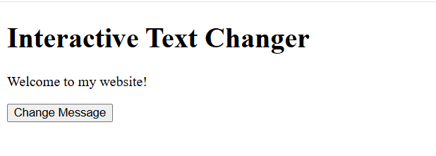
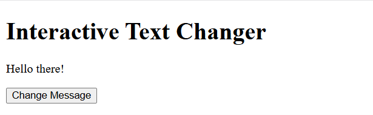
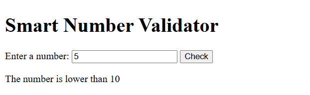
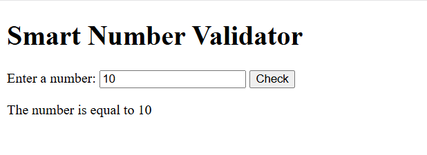
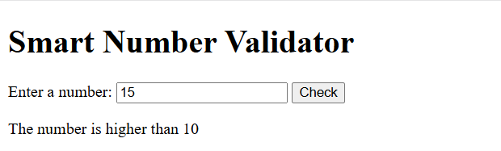
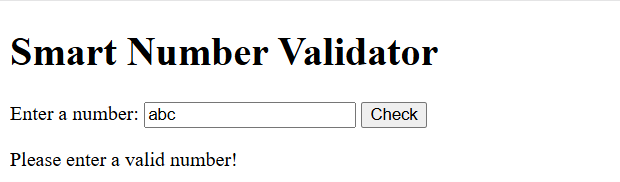
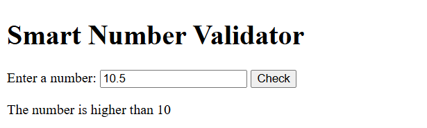
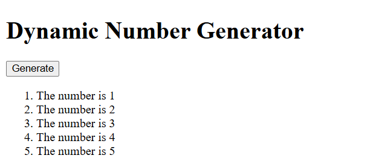

# bic21203-lab4a-javascript
Lab 4a: Client-Side Scripting (JavaScript) for BIC21203 Web Development

## Student Information

**Name:** SUMAIYYAH NADHIRAH BINTI MOHD AZMI 
**Matrics Number:** AI250073 
**Course Code:** BIC21203  

## 1. Introduction

This lab focuse on client-side scripting using JavaScript. The main objective is to develop interactive webpages by applying JavaScript functions, events, conditions, loops and DOM manipulation. The three programming tasks that has been completed will demonstrate the use of JavaScript in updating webpage content, validating user input and dynamically generating HTML elements.

## 2. Lab Activities

### Question 1: Interactive Text Changer

This task demonstrates the use of JavaScript functions and event handling. first, the webpage will displays "Welcome to my website!". After the user clicks the "Change Message" button, the paragraph changes to "Hello there!".

**JavaScript concepts used:**
- DOM selection using `getElementById()`.
- Functions using `changeMessage()`.
- Event handling using `addEventListener()`.
- Text modification using `textContent`.

### Question 2: Smart Number Validator

This task demonstrates how JavaScript validates user input and uses conditional statements. The user enters a number and clicks the "Check" button. Next, the webpage will displays a message indicating whether the number is lower than, higher than or equal to 10. Other than that, decimal numbers are valid and invalid inputs are also handled.

**JavaScript concepts used:**
- Reading user input using `.value`.
- Converting input using `Number()`.
- Input validation using `Number.isNaN()`.
- Conditional statements using `if`, `else if` and `else`.
- Displaying results using `textContent`.

### Question 3: Dynamic Number Generator

This task demonstrates the use of loops and DOM manipulation. When the user clicks the "Generate" button, JavaScript dynamically creates an ordered list containing numbers from 1 to 5. Existing list items are cleared before generating a new list.

**JavaScript concepts used:**
- Functions using `generateNumbers()`.
- For loops.
- Creating HTML elements using `document.createElement()`.
- Adding elements using `appendChild()`.
- Updating content using `textContent`.

## 3. Instructions to Run the Programs

1. Download or clone this GitHub repository.
2. Open the downloaded project folder.
3. Open the Q1, Q2 or Q3 folder.
4. Open the respective `index.html` file using a web browser or Visual Studio Code Live Server.
5. Follow the instructions on the webpage to test each program.

## 4. Screenshots of Outputs

### Question 1: Interactive Text Changer

### Question 2: Smart Number Validator

### Question 3: Dynamic Number Generator

## 5. Conclusion

This lab provided practical experience in using JavaScript to develop interactive webpages. Through the three tasks, I gained a better understanding of functions, event handling, conditional statements, input validation, loops and DOM manipulation. I also learned how JavaScript can dynamically update webpage content based on user interactions.
